# Puyo Puyo Sun English (Sega Saturn)

An English translation of the Sega Saturn game *Puyo Puyo Sun* (Compile,
1997, Japan only), made from the Japanese disc (Rev A) and the English
patch of the Windows version.

The Windows version of the game is a port of the Saturn one, and it has
an English translation patch made by the [Puyo Nexus](https://www.puyonexus.net)
community. This project takes the English text, font and pictures of
that patch and puts them on the Saturn disc. The parts of the Saturn game
the PC patch does not cover (rules demonstration, ranking labels, side
tags, the saved data messages, the Act Against AIDS message...) are
translated here in the same style. It follows the English translation of
the ST-V arcade version, [sega_st-v_puyosune](https://github.com/zanac/sega_st-v_puyosune).

All the translation work in the story scenes and the win quotes is from
the Puyo Nexus patch; credit for it goes to its authors.

The disc image is not in this repository: the build script makes it from
your own copy of the Japanese disc and the patch of the Windows version.

## Support
Hey dude! Help me out for a couple of :beers: or a :coffee:! 

## Building

Python 3, standard library only.

    python3 tools/make_saturn_puyosune.py "Puyo Puyo Sun (Japan) (Rev A) (10M).cue" Puyo_Puyo_Sun__English_Patched_.zip OUT_DIR

- The `.cue` is the Redump set of the Japanese disc, Rev A
  (track 1 CRC32 `e1afff40`, track 2 CRC32 `3f0834c8`).
- The zip is the Puyo Nexus English patch of the Windows version, as
  it comes (it holds `puyo3/grp.dat` and `puyo3/comic.scr`).

OUT_DIR receives `Puyo Puyo Sun (English).cue` and its two tracks. The
data track is rebuilt with every sector's EDC/ECC; the audio track is
copied. Expected result:

| File | Size | CRC32 |
|---|---|---|
| Puyo Puyo Sun (English) (Track 1).bin | 464755200 | `e176b23c` |
| Puyo Puyo Sun (English) (Track 2).bin | 5435472 | `3f0834c8` |

The boot header lists every region, so the disc boots on Japanese, US
and European consoles and BIOS images (checked with the US BIOS, which
refuses the Japanese disc).

## Status

| Part | State |
|---|---|
| Story scenes, 24 (167 pages) | English (Puyo Nexus), checked in the emulator |
| Win quotes, 69 | English (Puyo Nexus, the missing ones translated here), checked in the emulator |
| Title logo, game select (the four TV screens), course select, practice balloon | English, checked in the emulator |
| Map: story title plaques, difficulty, opponent names | English, checked in the emulator |
| In-game: YEAH!/OH NO!, All Clear!, curry levels, side tags | English, checked in the emulator |
| In-game: chain tag, Offset | English (patch pictures) |
| Rules demonstration | English, checked in the emulator |
| Continue, Game Over, ranking (difficulty labels, CHAIN, ENDLESS), name entry title | English, checked in the emulator |
| Results after the last stage (VS names, MAX CHAIN, Total) and the endings | English, checked in the emulator for the three courses (Draco, Arle, and Schezo with the secret stage against Carbuncle) |
| Endless (tokoton) mode: level select, Pause, rank and name | English, checked in the emulator |
| Two players: fighter select, rules menu, handicap levels | English, checked in the emulator |
| Options: setup, versus rules, gallery pages and key configuration | English, checked in the emulator |
| Sound test (music titles), atelier information page, message from AAA | English, checked in the emulator |
| Act Against AIDS screen (attract mode) | English slogan, checked in the emulator |
| Saved data messages (backup memory full or missing) | English; not seen on screen (they need a full or missing backup memory) |
| Story backgrounds: the curry stand's sign (Nohoho), the cleaning board (Kikimora) | English, checked in the emulator |
| Boot header with every region | done, checked with the US BIOS |

Left as they are: the voices; the animated opening (a video stream, with
the kana logo "Puyo Puyo" at its end, as on the PC version); the credits
roll, which is English already.

## Screenshots

| | |
|---|---|
| Title | 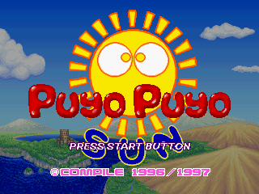 |
| Game select | 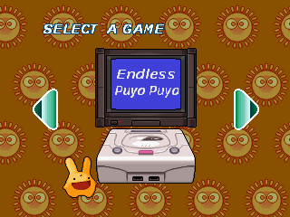 |
| Course select | 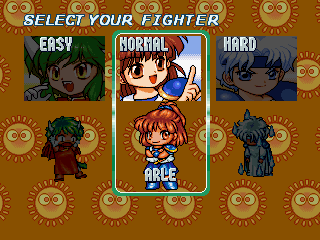 |
| Story scene | 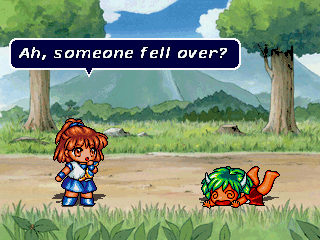 |
| Win quote | 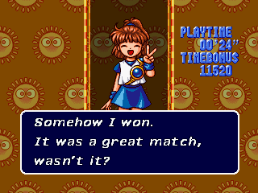 |
| Map | 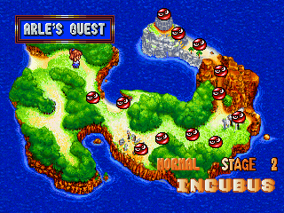 |
| Curry stand (story background) | 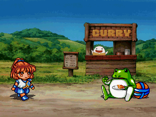 |
| Cleaning board (story background) | 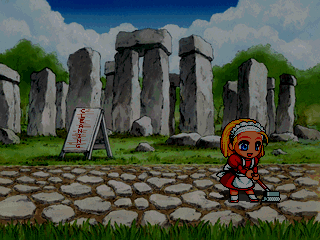 |
| Rules demonstration | 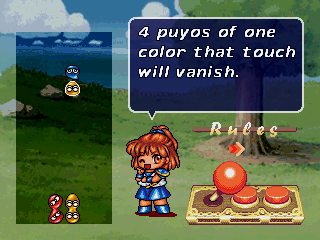 |
| Pause (endless mode) | 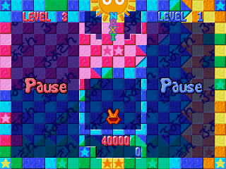 |
| Name entry | 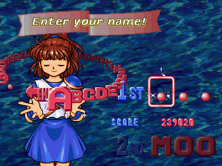 |
| Ranking | 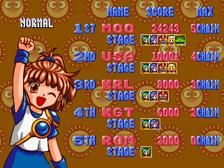 |
| Results | 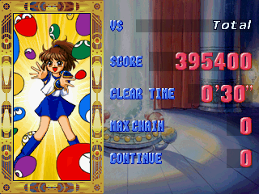 |
| Ending | 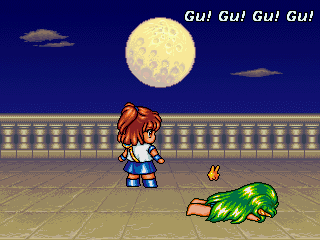 |
| Two players: rules | 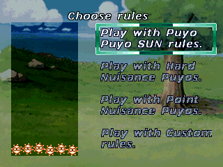 |
| Two players: handicap | 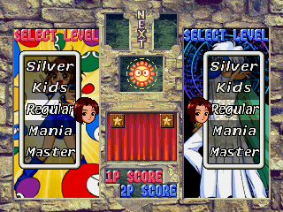 |
| Options | 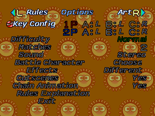 |
| Options: versus rules | 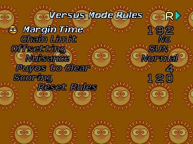 |
| Options: gallery | 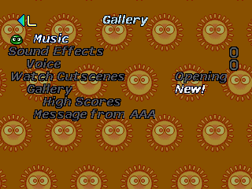 |
| Sound test | 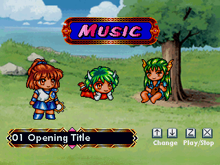 |
| Message from AAA |  |

## How it works

- `tools/disc.py`: the data track and its ISO 9660 file system; a file
  that grows goes to the end of the track (the game opens its files by
  name).
- `tools/spr.py`: the sprite sets (`.SPR`, the same format as the arcade
  cartridge). A set may not take more pixels than the original: the
  game gives each one that room in video memory.
- `tools/text.py`: the font of the patch in the two text sets, a small
  patch in the text engine of the program (proportional advance from a
  width table, flag 0x40), and the win quotes. New texts go in the free
  end of the program file (0x060d1000-0x060dc000).
- `tools/story.py`: the 24 story scenes. The Saturn and Windows scenes
  have the same events at the same times, so each page gets the page of
  the patch, with its own pauses and typing speed.
- The other modules each handle one screen; `tools/build.py` runs them
  all.
